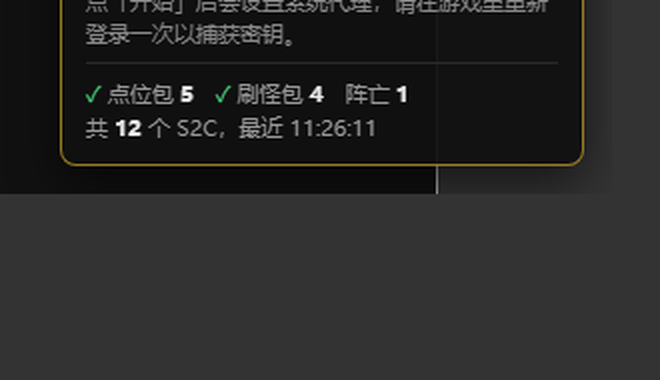
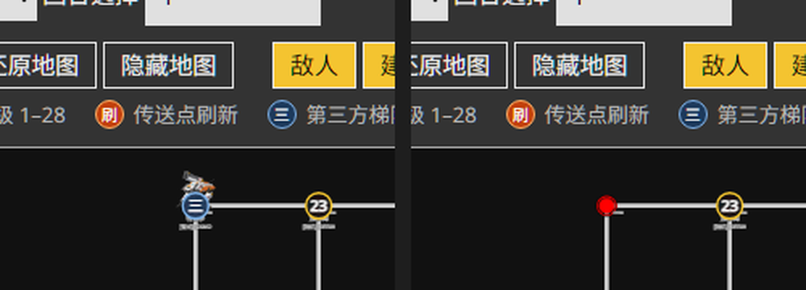
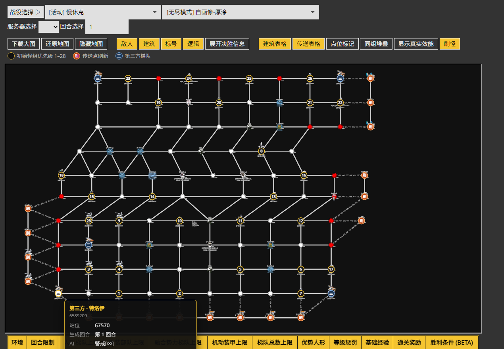
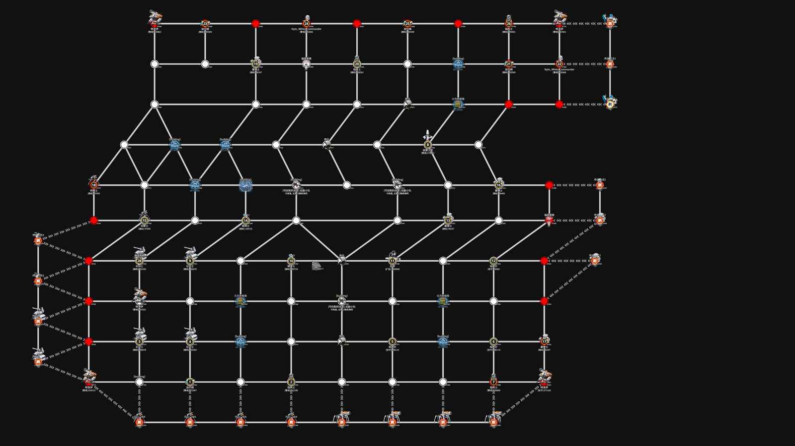

# 地图 Demo使用说明

## 一、工程结构

```
GFLH-SlowShock/
├── map.py               # 启动主程序（本地服务 + 抓包 + WebView2 窗口）
├── gflmaps/             # 前端网页文件夹 (包含 index.html, main.js, style.css, images 等)
│   ├── tools/           # 离线数据 -> 地图数据的转换脚本
│   ├── data/spawn/      # 刷怪图层数据（每张图一个 json）
│   ├── control-panel.js # 窗口右下角的抓包控制面板（走 /api/*）
│   └── preview/         # 刷怪图层的截图
├── mk/                  # PyInstaller 打包脚本（map.spec / build_map.py）
├── tables/              # 单图表格提取与渲染（见 tables/README.md）
├── GFLData/             # 离线数据（只留 ch 用到的表，约 122 MB，已 gitignore）
└── dist/                # 打包产物（已 gitignore）
```

其中：

1. `gflzirc`可以通过PYPI: `pip install gflzirc`安装；
2. `gflmaps`对应**MaaGF1/maps**仓库的内容，其中`main.js`用的是本目录改过的版本（刷怪图层、实时更新、控制面板）；
3. `GFLData`对应**MaaGF1/GFLData**中的数据；
4. `tables`只读取`GFLData`，不依赖上面两项：`python extract.py` 生成数据，`python serve.py` 即可单独查看某张图的表格。

## 二、刷怪图层

地图画布上多了一层“刷怪”标记，数据来自 `S2C_Mission_teamMove`（1T）与 `S2C_Mission_startTurn`（2T 起）：

* **数字圆点**：初始怪组，编号就是 `enemy_instance_info` 的顺序（1–28），也就是行动优先级；
* **橙色“刷”圆点**：从传送点刷出来的怪组（`ally_instance_info` 里 `ally_type=2`、且不在静态点位上的队伍），点位取自 `ai_para` 的 `@67672`；
* **蓝色“三”圆点**：开局就在静态点位上的第三方梯队（`ally_team`，例如四个点位上的“特洛伊”）。它们不算刷新，但同样有标记和悬停信息；
* **鼠标悬停**：显示怪组组成、效能、生成回合、行动逻辑（和 `刷怪表.xlsx` / `初始怪组表.xlsx` 对得上）；
* **工具栏“刷怪”**：开关这一层；图例会说明三种圆点；
* **阵亡抹除**：`died_enemy` / `died_ally` 里出现的队伍会被记为阵亡，下一次重绘时点位、标记、底图小人和表格一起消失；第三方梯队（特洛伊）另外按“点位上的 `ally_instance_ids` 空了”判定，不依赖 `died_*`，而且打掉它不会把点位改成我方（保持敌占区）；
* **抓包统计**：窗口右下角面板会显示已捕获的点位包 / 刷怪包 / 阵亡包数量和最近时间，一个都没收到时会提示回游戏重新登录。






本图一共 27 个初始怪组 + 18 个传送点刷新 + 5 个第三方梯队 = 50 个标记（有阵亡会相应减少）。



### 2.1 生成数据

```bash
python gflmaps/tools/spawn_extract.py --mission 11403 \
  --team-move "D:\Github\GFLH\GFLH-SlowShock\0039_S2C_4000_Mission_teamMove_1792629961.json" \
  --start-turn "D:\Github\GFLH\GFLH-SlowShock\0189_S2C_5000_Mission_startTurn_1793005345.json"
```

输出 `gflmaps/data/spawn/mission-11403.json`，页面会按当前任务 ID 自动加载（没有就当作没有刷怪数据）。

### 2.2 定位规则（夜战的坑）

夜战里 `spot_act_info` 只包含视野内的点位（这张图 112 个点里只有 44–45 个），所以初始怪组的点位按下面顺序推：

1. `enemy_ai_para` 里的 `@spot`；
2. `night_enemy` 的 `from_spot_id`（按 `enemy_instance_id` 对）；
3. `spot_act_info` 里该怪组唯一的可见点位；
4. 同一怪组按点位 id 升序、按 `enemy_instance_info` 编号升序回填。

`instance 27 (6589999)` 在抓包里没有任何点位信息，落在“unplaced”里不画。

### 2.3 实时更新

`map.py` 收到带 `enemy_instance_info` / `ally_instance_info` 的 S2C 包时，会通过 SSE（`/api/stream`）把包推给页面里的 `window.updateSpawnLive(packet)`；前端用同一套规则重算，所以 1T 抓一次就能看到全部刷怪点，2T 的 `startTurn` 会覆盖成新一回合的分布。

高频包会合并重绘（120ms 一次），避免 1T 大量 `teamMove` 把界面拖卡。



## 三、打包成 exe

```bash
python mk/build_map.py                                  # 输出到 ./dist
python mk/build_map.py --no-data                        # 不带 GFLData（体积小，联网取数据）
python mk/build_map.py --out "D:\Github\GFLH\GFLH-SlowShock\dist"
```

产物（onedir，和 GFLH 其它工具一致）：

```
GFLH-SlowShockMap/
├── GFLH-SlowShockMap.exe
├── _internal/              # Python 运行时
├── gflmaps/                # 前端 + 图片 + 刷怪数据
├── GFLData/ch/             # 离线数据（--no-data 时不带）
└── 使用说明.txt
```

打包版优先用 **WebView2**（pywebview）开窗口：

1. 起本地服务 `http://127.0.0.1:8081`；
2. `webview.start(gui='edgechromium')` 打开地图窗口，关掉窗口即退出；
3. 窗口右下角的「抓包监控」面板通过 `/api/status|start|stop|quit|stream` 控制代理、接收实时包。

如果 WebView2 起不来（打包版在本目录下的 CLR 问题见 `README.md` 的记录），会自动降级：
Edge/Chrome 应用窗口 → 默认浏览器 → 保持本地服务并提示手动打开 `http://127.0.0.1:8081/`。
用普通静态服务器打开页面时不会出现控制面板，不影响单纯看地图。

## 四、依赖

### 3.1 基础部分

1. PYPI: `gflzirc`、`pywebview`、`pythonnet`、`pyinstaller`
2. WebView2 Runtime（源码运行与打包版都需要）
3. 浏览器: Edge 或 Chrome（降级兜底时用）

### 3.2 WebView2

1. 前往微软官方 WebView2 下载页：
	`https://developer.microsoft.com/zh-cn/microsoft-edge/webview2/`
2. 在页面中下方的 **常青版独立安装程序 (Evergreen Standalone Installer)** 中，选择 **x64(或对应版本)** 进行下载。

## 五、CI（GitHub Actions）

工作流：`.github/workflows/build_SlowShock.yml`（和仓库里其它工具同一套写法）。

- **触发**：改动 `GFLH-SlowShock/{map.py,gflmaps/**,mk/**}` 或工作流本身；打 `vSlowShock*` 标签会额外发 Release；也可以在 Actions 页面手动跑（`workflow_dispatch`）。
- **构建**：`windows-latest` + Python 3.11 + `mk/requirements.txt`，执行 `python GFLH-SlowShock/mk/build_map.py`。
- **离线数据**：`GFLData` 不入库，工作流会用 `--filter=blob:none --sparse` 只拉 `ch` 目录再打包；拉取失败或手动关掉 `with_data` 时自动退化成 `--no-data`（纯在线版）。
- **产物**：Artifact `GFLH-SlowShockMap-win-x86_64`；发布 Release 时打成 `GFLH-SlowShockMap-win-x86_64.zip`。


